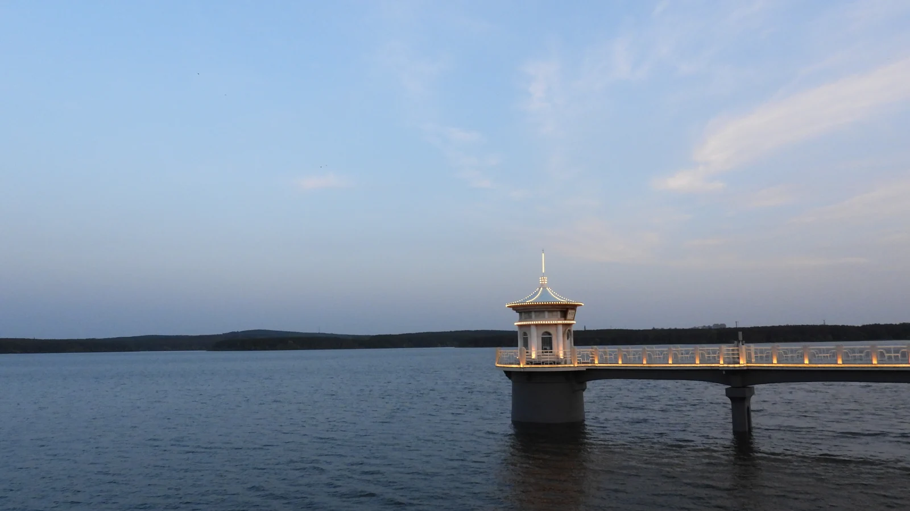

<link rel="stylesheet" href="/assets/horizon/research.css?v=research-3">
<link rel="stylesheet" href="/assets/horizon/home-motion.css?v=home-4">

<svg class="project-defs" width="0" height="0" aria-hidden="true" focusable="false"><defs><linearGradient id="project-beam" gradientUnits="userSpaceOnUse" x1="24" y1="0" x2="296" y2="0"><stop offset="0" stop-color="#6fe3ff"/><stop offset=".55" stop-color="#b48cff"/><stop offset="1" stop-color="#ff6f7d"/></linearGradient></defs></svg>

<section class="horizon-intro section" aria-labelledby="intro-title">
  

    
Chemistry PhD · Brown University

    <h1 id="intro-title" data-reveal data-delay="60">Zhongqi Xiu 修中淇</h1>
    
Exploring light, quantum materials,  and the physics in between.

    
I’m a second-year graduate researcher at <a href="https://www.brown.edu/">Brown University</a> in <a href="https://www.yusongbai.org/">Yusong Bai’s Group</a>, studying excitonic physics, quantum states, and two-dimensional materials.

    
<a class="button" href="/projects/">Explore research →</a><a class="button-secondary" href="/cv/">View CV</a>

  

</section>

<section class="landscape-carousel" data-carousel aria-label="Landscapes through my lens" aria-roledescription="carousel">
<figure class="landscape-slide" role="group" aria-roledescription="slide" aria-label="1 of 4" data-caption="Blue hour."><picture><source media="(max-width:640px)" srcset="/assets/horizon/lake-blue-mobile-1000.webp"></picture></figure><figure class="landscape-slide" role="group" aria-roledescription="slide" aria-label="2 of 4" data-caption="Last light."><picture><source media="(max-width:640px)" srcset="/assets/horizon/lake-sunset-mobile-1000.webp"></picture></figure><figure class="landscape-slide" role="group" aria-roledescription="slide" aria-label="3 of 4" data-caption="Desert horizon."><picture><source media="(max-width:640px)" srcset="/assets/horizon/desert-mobile-1000.webp"></picture></figure><figure class="landscape-slide" role="group" aria-roledescription="slide" aria-label="4 of 4" data-caption="Water and stone."><picture><source media="(max-width:640px)" srcset="/assets/horizon/garden-waterfall-mobile-1000.webp"></picture></figure>

Blue hour.1 / 4

<button type="button" data-slide="0" aria-label="Show photograph 1: Blue hour" aria-current="true"></button><button type="button" data-slide="1" aria-label="Show photograph 2: Last light" aria-current="false"></button><button type="button" data-slide="2" aria-label="Show photograph 3: Desert horizon" aria-current="false"></button><button type="button" data-slide="3" aria-label="Show photograph 4: Water and stone" aria-current="false"></button>

<button type="button" data-previous aria-label="Previous photograph" disabled>←</button><button type="button" data-next aria-label="Next photograph">→</button>

</section>

<section class="section horizon-research" aria-labelledby="research-heading">
  

    
<h2 id="research-heading">Questions that guide my work.</h2>
From individual photons and atoms to collective behavior in two-dimensional materials.

    

      <article class="horizon-research-card" data-reveal>
        
<svg viewBox="0 0 320 160" aria-hidden="true" focusable="false"><path class="fx dash" d="M98 24 L160 44 L172 104 L120 140 L52 128 L30 70 Z"/><circle class="cy glow" cx="84" cy="62" r="4"/><circle class="vi glow" cx="132" cy="92" r="3"/><circle class="vi glow" cx="136" cy="96" r="3"/><circle class="co glow" cx="70" cy="108" r="3"/><circle class="co glow" cx="74" cy="104" r="3"/><circle class="ring" cx="84" cy="62" r="9"/><path class="fx" d="M202 26 V78 H308"/><path class="ln thin" d="M202 78 L202 77.7 L203 77.7 L204 77.7 L205 77.6 L206 77.6 L207 77.5 L208 77.5 L209 77.5 L210 77.4 L211 77.4 L212 77.3 L213 77.2 L214 77.2 L215 77.1 L216 77 L217 77 L218 76.9 L219 76.8 L220 76.7 L221 76.6 L222 76.5 L223 76.4 L224 76.2 L225 76.1 L226 76 L227 75.8 L228 75.7 L229 75.5 L230 75.3 L231 75.2 L232 75 L233 74.8 L234 74.5 L235 74.3 L236 74 L237 73.7 L238 73.3 L239 72.9 L240 72.4 L241 71.8 L242 71 L243 69.9 L244 68.5 L245 66.5 L246 63.5 L247 59.3 L248 53.4 L249 47.2 L250 44.1 L251 47.1 L252 53.3 L253 59 L254 63.2 L255 66.1 L256 68 L257 69.4 L258 70.3 L259 71.1 L260 71.6 L261 72.1 L262 72.4 L263 72.8 L264 73 L265 73.3 L266 73.5 L267 73.7 L268 73.9 L269 74.1 L270 74.2 L271 74.4 L272 74.6 L273 74.7 L274 74.9 L275 75 L276 75.2 L277 75.3 L278 75.4 L279 75.6 L280 75.7 L281 75.8 L282 76 L283 76.1 L284 76.2 L285 76.3 L286 76.4 L287 76.5 L288 76.6 L289 76.7 L290 76.8 L291 76.9 L292 77 L293 77.1 L294 77.1 L295 77.2 L296 77.3 L297 77.3 L298 77.4 L299 77.4 L300 77.5 L301 77.5 L302 77.6 L303 77.6 L304 77.6 L305 77.7 L306 77.7 L307 77.7 L308 77.7"/><rect class="dim" x="202" y="108" width="2.2" height="34"/><rect class="dim" x="205.4" y="108" width="2.2" height="34"/><rect class="dim" x="208.9" y="108" width="2.2" height="34"/><rect class="dim" x="212.3" y="108.1" width="2.2" height="33.9"/><rect class="dim" x="215.8" y="108.1" width="2.2" height="33.9"/><rect class="dim" x="219.2" y="108.2" width="2.2" height="33.8"/><rect class="dim" x="222.7" y="108.3" width="2.2" height="33.7"/><rect class="dim" x="226.2" y="108.4" width="2.2" height="33.6"/><rect class="dim" x="229.6" y="108.8" width="2.2" height="33.2"/><rect class="dim" x="233.1" y="109.3" width="2.2" height="32.7"/><rect class="dim" x="236.5" y="110.1" width="2.2" height="31.9"/><rect class="dim" x="239.9" y="111.5" width="2.2" height="30.5"/><rect class="dim" x="243.4" y="113.8" width="2.2" height="28.2"/><rect class="dim" x="246.8" y="117.8" width="2.2" height="24.2"/><rect class="dim" x="250.3" y="124.3" width="2.2" height="17.7"/><rect class="dim" x="253.8" y="135.2" width="2.2" height="6.8"/><rect class="dim" x="257.2" y="124.3" width="2.2" height="17.7"/><rect class="dim" x="260.6" y="117.8" width="2.2" height="24.2"/><rect class="dim" x="264.1" y="113.8" width="2.2" height="28.2"/><rect class="dim" x="267.6" y="111.5" width="2.2" height="30.5"/><rect class="dim" x="271" y="110.1" width="2.2" height="31.9"/><rect class="dim" x="274.4" y="109.3" width="2.2" height="32.7"/><rect class="dim" x="277.9" y="108.8" width="2.2" height="33.2"/><rect class="dim" x="281.4" y="108.4" width="2.2" height="33.6"/><rect class="dim" x="284.8" y="108.3" width="2.2" height="33.7"/><rect class="dim" x="288.2" y="108.2" width="2.2" height="33.8"/><rect class="dim" x="291.7" y="108.1" width="2.2" height="33.9"/><rect class="dim" x="295.1" y="108.1" width="2.2" height="33.9"/><rect class="dim" x="298.6" y="108" width="2.2" height="34"/><rect class="dim" x="302.1" y="108" width="2.2" height="34"/><rect class="dim" x="305.5" y="108" width="2.2" height="34"/><path class="fx" d="M202 142 H308"/></svg>

        <h3>Quantum light.</h3>
Single-photon emission, optical spectroscopy, and strain engineering in two-dimensional materials.
<a class="text-link" href="/projects/#project-2">Explore the experiments →</a>
      </article>
      <article class="horizon-research-card" data-reveal data-delay="80">
        
<svg viewBox="0 0 320 160" aria-hidden="true" focusable="false"><rect class="dim" x="12" y="14.0" width="94" height="2.6"/><rect class="dim" x="12" y="126.0" width="94" height="2.6"/><rect class="dim" x="12" y="19.5" width="94" height="2.6"/><rect class="dim" x="12" y="131.5" width="94" height="2.6"/><rect class="dim" x="12" y="25.0" width="94" height="2.6"/><rect class="dim" x="12" y="137.0" width="94" height="2.6"/><rect class="dim" x="12" y="30.5" width="94" height="2.6"/><rect class="dim" x="12" y="142.5" width="94" height="2.6"/><rect class="vi" x="20" y="78" width="78" height="1.6"/><rect class="co" x="20" y="80.6" width="78" height="1.6"/><path class="fx dash" d="M132 130.4 L306 37.6"/><path class="fx dash" d="M132 84 L306 84"/><path class="ln" d="M132 83 L136.3 82.9 L140.7 82.9 L145.1 82.8 L149.4 82.7 L153.8 82.7 L158.1 82.6 L162.4 82.5 L166.8 82.4 L171.2 82.2 L175.5 82.1 L179.8 81.9 L184.2 81.7 L188.6 81.4 L192.9 81.1 L197.2 80.7 L201.6 80.3 L206 79.7 L210.3 79 L214.6 78.1 L219 77 L223.4 75.8 L227.7 74.3 L232.1 72.7 L236.4 71 L240.8 69.1 L245.1 67.2 L249.4 65.2 L253.8 63.1 L258.1 61 L262.5 58.9 L266.9 56.7 L271.2 54.5 L275.5 52.3 L279.9 50.1 L284.2 47.9 L288.6 45.6 L292.9 43.4 L297.3 41.1 L301.6 38.8 L306 36.6"/><path class="ln" d="M132 131.4 L136.3 129.2 L140.7 126.9 L145.1 124.6 L149.4 122.4 L153.8 120.1 L158.1 117.9 L162.4 115.7 L166.8 113.5 L171.2 111.3 L175.5 109.1 L179.8 107 L184.2 104.9 L188.6 102.8 L192.9 100.8 L197.2 98.9 L201.6 97 L206 95.3 L210.3 93.7 L214.6 92.2 L219 91 L223.4 89.9 L227.7 89 L232.1 88.3 L236.4 87.7 L240.8 87.3 L245.1 86.9 L249.4 86.6 L253.8 86.3 L258.1 86.1 L262.5 85.9 L266.9 85.8 L271.2 85.6 L275.5 85.5 L279.9 85.4 L284.2 85.3 L288.6 85.3 L292.9 85.2 L297.3 85.1 L301.6 85.1 L306 85"/><path class="ln thin" d="M59 36 Q75 80 59 124"/><path class="fx" d="M59 36 Q43 80 59 124"/></svg>

        <h3>Atoms & cavities.</h3>
Fiber cavity quantum electrodynamics, atom trapping, and the control of light–matter interactions.
<a class="text-link" href="/projects/#project-4">See the research →</a>
      </article>
      <article class="horizon-research-card" data-reveal data-delay="160">
        
<svg viewBox="0 0 320 160" aria-hidden="true" focusable="false"><path class="fx" d="M16 16 V120 H308"/><circle class="dt dim" cx="18" cy="111" r="2"/><circle class="dt dim" cx="24.3" cy="112.8" r="2"/><circle class="dt dim" cx="30.6" cy="122.8" r="2"/><circle class="dt dim" cx="36.9" cy="115.6" r="2"/><circle class="dt dim" cx="43.2" cy="109.2" r="2"/><circle class="dt dim" cx="49.6" cy="119.5" r="2"/><circle class="dt dim" cx="55.9" cy="120.2" r="2"/><circle class="dt dim" cx="62.2" cy="109.1" r="2"/><circle class="dt dim" cx="68.5" cy="113.9" r="2"/><circle class="dt dim" cx="74.8" cy="121.9" r="2"/><circle class="dt dim" cx="81.1" cy="112.3" r="2"/><circle class="dt dim" cx="87.4" cy="108.4" r="2"/><circle class="dt dim" cx="93.7" cy="119" r="2"/><circle class="dt dim" cx="100" cy="115.7" r="2"/><circle class="dt dim" cx="106.4" cy="104.8" r="2"/><circle class="dt dim" cx="112.7" cy="110.8" r="2"/><circle class="dt dim" cx="119" cy="114.1" r="2"/><circle class="dt dim" cx="125.3" cy="99.2" r="2"/><circle class="dt dim" cx="131.6" cy="91.9" r="2"/><circle class="dt dim" cx="137.9" cy="90.2" r="2"/><circle class="dt dim" cx="144.2" cy="66.3" r="2"/><circle class="dt dim" cx="150.5" cy="48.4" r="2"/><circle class="dt dim" cx="156.8" cy="71.3" r="2"/><circle class="dt dim" cx="163.2" cy="91.8" r="2"/><circle class="dt dim" cx="169.5" cy="92.1" r="2"/><circle class="dt dim" cx="175.8" cy="101.7" r="2"/><circle class="dt dim" cx="182.1" cy="115" r="2"/><circle class="dt dim" cx="188.4" cy="109.3" r="2"/><circle class="dt dim" cx="194.7" cy="105.6" r="2"/><circle class="dt dim" cx="201" cy="117.5" r="2"/><circle class="dt dim" cx="207.3" cy="117.7" r="2"/><circle class="dt dim" cx="213.6" cy="107.7" r="2"/><circle class="dt dim" cx="220" cy="114.1" r="2"/><circle class="dt dim" cx="226.3" cy="121.9" r="2"/><circle class="dt dim" cx="232.6" cy="112.1" r="2"/><circle class="dt dim" cx="238.9" cy="110.2" r="2"/><circle class="dt dim" cx="245.2" cy="121.5" r="2"/><circle class="dt dim" cx="251.5" cy="117.9" r="2"/><circle class="dt dim" cx="257.8" cy="108.8" r="2"/><circle class="dt dim" cx="264.1" cy="117.5" r="2"/><circle class="dt dim" cx="270.4" cy="122.2" r="2"/><circle class="dt dim" cx="276.8" cy="111.3" r="2"/><circle class="dt dim" cx="283.1" cy="112.5" r="2"/><circle class="dt dim" cx="289.4" cy="122.9" r="2"/><circle class="dt dim" cx="295.7" cy="116.3" r="2"/><circle class="dt dim" cx="302" cy="109.5" r="2"/><path class="ln" d="M18 116.1 L20 116.1 L22 116.1 L24 116.1 L26 116.1 L28 116 L30 116 L32 116 L34 116 L36 115.9 L38 115.9 L40 115.9 L42 115.8 L44 115.8 L46 115.8 L48 115.7 L50 115.7 L52 115.7 L54 115.6 L56 115.6 L58 115.5 L60 115.5 L62 115.4 L64 115.3 L66 115.3 L68 115.2 L70 115.1 L72 115.1 L74 115 L76 114.9 L78 114.8 L80 114.7 L82 114.6 L84 114.4 L86 114.3 L88 114.1 L90 114 L92 113.8 L94 113.6 L96 113.4 L98 113.1 L100 112.8 L102 112.5 L104 112.2 L106 111.8 L108 111.3 L110 110.8 L112 110.3 L114 109.6 L116 108.9 L118 108 L120 107 L122 105.8 L124 104.4 L126 102.8 L128 100.8 L130 98.5 L132 95.6 L134 92.3 L136 88.2 L138 83.5 L140 78.1 L142 72.1 L144 66 L146 60.5 L148 56.6 L150 55.2 L152 56.6 L154 60.5 L156 66 L158 72.1 L160 78.1 L162 83.5 L164 88.2 L166 92.3 L168 95.6 L170 98.5 L172 100.8 L174 102.8 L176 104.4 L178 105.8 L180 107 L182 108 L184 108.9 L186 109.6 L188 110.3 L190 110.8 L192 111.3 L194 111.8 L196 112.2 L198 112.5 L200 112.8 L202 113.1 L204 113.4 L206 113.6 L208 113.8 L210 114 L212 114.1 L214 114.3 L216 114.4 L218 114.6 L220 114.7 L222 114.8 L224 114.9 L226 115 L228 115.1 L230 115.1 L232 115.2 L234 115.3 L236 115.3 L238 115.4 L240 115.5 L242 115.5 L244 115.6 L246 115.6 L248 115.7 L250 115.7 L252 115.7 L254 115.8 L256 115.8 L258 115.8 L260 115.9 L262 115.9 L264 115.9 L266 116 L268 116 L270 116 L272 116 L274 116.1 L276 116.1 L278 116.1 L280 116.1 L282 116.1 L284 116.1 L286 116.2 L288 116.2 L290 116.2 L292 116.2 L294 116.2 L296 116.2 L298 116.2 L300 116.3 L302 116.3"/><path class="fx" d="M18 144 H302"/></svg>

        <h3>Tools for discovery.</h3>
Numerical models and practical software for spectroscopy, data analysis, and experiments.
<a class="text-link" href="/projects/#project-3">Browse the tools →</a>
      </article>
    

  

</section>

<section class="section horizon-publication" aria-labelledby="publication-heading">
  

    
<h2 id="publication-heading">Selected publication.</h2><a class="text-link" href="/publications/">All publications →</a>

    <article class="horizon-paper" data-reveal data-delay="80">
      

Nano Letters
2025 · Published

      
<h3><a href="https://doi.org/10.1021/acs.nanolett.5c01718">Ultrahigh-Purity Single-Photon Emission from 2D WSe2 via Effective Suppression of Classical Emission</a></h3>
Wenjing Wu, Alex Strasser, <strong>Zhongqi Xiu</strong>, et al.
<a class="text-link" href="https://doi.org/10.1021/acs.nanolett.5c01718">Read the paper ↗</a>

    </article>
  

</section>

<section class="section horizon-journey" aria-labelledby="journey-heading">
  

    
<h2 id="journey-heading">The path so far.</h2><a class="text-link" href="/cv/">Full CV →</a>

    

      <article data-reveal>
2025 — Present

<h3>Brown University</h3>
Chemistry PhD program.

</article>
      <article data-reveal>
2024 — 2025

<h3>Rice University</h3>
Research at the SCOPE Lab with Prof. Shengxi Huang and Wenjing Wu, studying single-photon emission in two-dimensional materials.

</article>
      <article data-reveal>
2021 — 2025

<h3>University of Science and Technology of China</h3>
Bachelor’s degree in physics, focused on optics and optical engineering. Research in fiber cavity quantum electrodynamics at the CAS Key Laboratory of Quantum Information.
<a class="text-link" href="/assets/bachelor_thesis.pdf" download>Bachelor’s thesis ↓PDF</a>
</article>
    

  

</section>

<section class="section horizon-outside" aria-labelledby="outside-heading">
  

    
<h2 id="outside-heading">Beyond the lab.</h2>
Music, travel, and a different way of looking.

    

      <article data-reveal><svg viewBox="0 0 40 40" focusable="false"><defs><linearGradient id="glyph-beam-a" x1="0" y1="0" x2="1" y2="1"><stop offset="0" stop-color="#22b8e6"/><stop offset=".55" stop-color="#8f62ff"/><stop offset="1" stop-color="#ff5a6e"/></linearGradient></defs><circle class="glyph-light" cx="20" cy="20" r="6"/><circle class="glyph-ring" cx="20" cy="20" r="16"/><g class="glyph-blades"><path d="M20 4 L28.99 24.22"/><path d="M33.86 12 L20.84 29.89"/><path d="M33.86 28 L11.85 25.68"/><path d="M20 36 L11.01 15.78"/><path d="M6.14 28 L19.16 10.11"/><path d="M6.14 12 L28.15 14.32"/></g></svg><h3>A moment, kept.</h3>
Photography, journeys, and details worth pausing for.
<a class="text-link" href="/gallery/">Browse the gallery →</a></article>
      <article data-reveal data-delay="80"><svg viewBox="0 0 40 40" focusable="false"><defs><linearGradient id="glyph-beam-b" x1="0" y1="0" x2="1" y2="1"><stop offset="0" stop-color="#22b8e6"/><stop offset=".55" stop-color="#8f62ff"/><stop offset="1" stop-color="#ff5a6e"/></linearGradient></defs><g class="glyph-bars"><rect x="5" y="24" width="3.6" height="12" rx="1.8" style="--i:0"/><rect x="11.5" y="14" width="3.6" height="22" rx="1.8" style="--i:1"/><rect x="18.2" y="6" width="3.6" height="30" rx="1.8" style="--i:2"/><rect x="24.9" y="18" width="3.6" height="18" rx="1.8" style="--i:3"/><rect x="31.4" y="26" width="3.6" height="10" rx="1.8" style="--i:4"/></g></svg><h3>Another kind of wavelength.</h3>
I was principal player of the wind section in the School Folk Orchestra from 2021 to 2023.
<a class="text-link" href="/music/">Listen to my playlist →</a></article>
    

  

</section>

<section class="section horizon-contact" aria-labelledby="contact-heading">
  
<h2 id="contact-heading">Let’s exchange ideas.</h2>
Questions about the research, or something we share an interest in?
<a class="button" href="/contact/">Get in touch →</a>

</section>
